<div align="center">

# 🔍 Laboratorio 14 — Desarrollo de Aplicaciones Web Avanzado

### Optimización SEO en Next.js — Meta Tags, Sitemap, Robots.txt y Core Web Vitals


*Tecsup · Diseño y Desarrollo de Software · Desarrollo de Aplicaciones Web Avanzado*

</div>

---

## 📖 Tabla de contenidos

- [Descripción general](#-descripción-general)
- [Stack técnico](#-stack-técnico)
- [Estructura del proyecto](#-estructura-del-proyecto)
- [Parte 1 — Meta tags dinámicos](#-parte-1--meta-tags-dinámicos)
- [Parte 2 — Componentes compartidos y optimización de imágenes](#-parte-2--componentes-compartidos-y-optimización-de-imágenes)
- [Parte 3 — Sitemap y robots.txt](#️-parte-3--sitemap-y-robotstxt)
- [Verificación con Chrome DevTools y Lighthouse](#-verificación-con-chrome-devtools-y-lighthouse)
- [Tarea — Contacto, despliegue y dominio](#-tarea--contacto-despliegue-y-dominio)
- [Conclusiones](#-conclusiones)
- [Autor](#-autor)

---

## 📌 Descripción general

Este repositorio contiene un portafolio personal construido en Next.js (App Router), pensado como ejercicio práctico de SEO técnico: metadatos dinámicos por página, tarjetas Open Graph y Twitter, generación nativa de `sitemap.xml` y `robots.txt`, y optimización de imágenes con `next/image`. Los resultados se verificaron con Chrome DevTools y auditorías de Lighthouse en modo Desktop y Mobile.

## 🧰 Stack técnico


## 🗂 Estructura del proyecto

```
src/
├── app/
│   ├── layout.tsx              # Metadata global, Open Graph, Twitter cards
│   ├── page.tsx                 # Home
│   ├── about/
│   │   └── page.tsx
│   ├── contact/
│   │   ├── page.tsx             # Formulario de contacto (Client Component)
│   │   └── layout.tsx           # Metadata de /contact (no puede ir en page.tsx porque es 'use client')
│   ├── projects/
│   │   ├── page.tsx
│   │   └── [slug]/
│   │       └── page.tsx         # generateMetadata dinámico por proyecto
│   ├── sitemap.ts                # Sitemap generado dinámicamente
│   └── robots.ts                 # robots.txt generado dinámicamente
├── components/
│   ├── Header.tsx
│   ├── Footer.tsx
│   └── ProjectCard.tsx
├── lib/
│   └── data.ts                   # Datos de proyectos e info personal
└── types/
    └── index.ts
```

## 🔖 Parte 1 — Meta tags dinámicos

El `layout.tsx` raíz define metadata estática global (título con plantilla `%s | Nombre`, descripción, keywords, Open Graph y Twitter cards), mientras que la página de detalle de proyecto (`projects/[slug]/page.tsx`) usa `generateMetadata` para construir metadatos distintos por cada proyecto a partir de su slug, incluyendo su propia imagen Open Graph. Esto permite que cada URL del sitio tenga un título, descripción e imagen de vista previa correctos al compartirse en redes sociales.

<table>
<tr>
<td width="50%">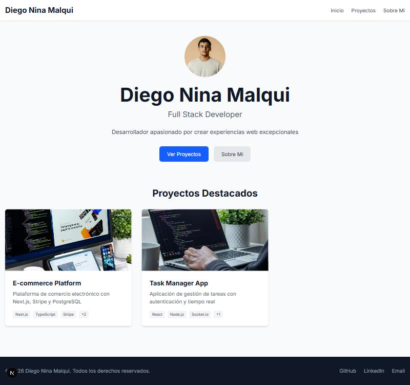</td>
<td width="50%">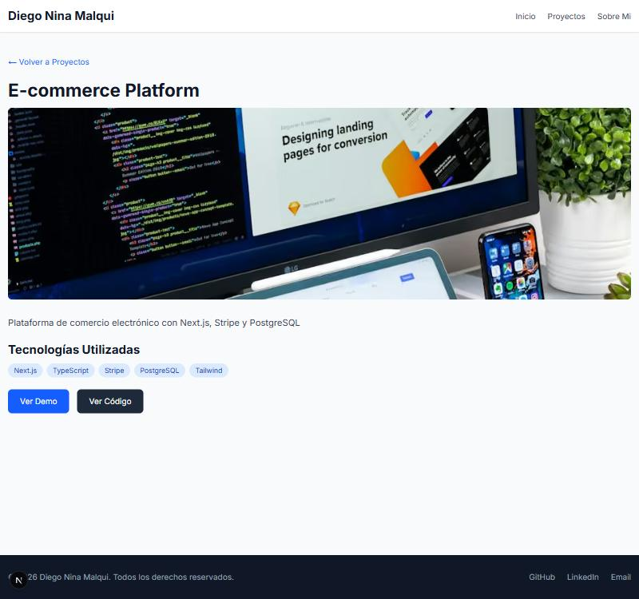</td>
</tr>
</table>

## 🧩 Parte 2 — Componentes compartidos y optimización de imágenes

`Header` y `Footer` se comparten entre todas las páginas desde el layout raíz, evitando duplicar la navegación. Las imágenes de los proyectos (hospedadas en Unsplash) se sirven con `next/image`, que las optimiza automáticamente a formatos modernos (AVIF/WebP) y aplica lazy loading fuera del viewport inicial; `next.config.ts` declara `remotePatterns` para autorizar el dominio de Unsplash como origen de imágenes remotas.

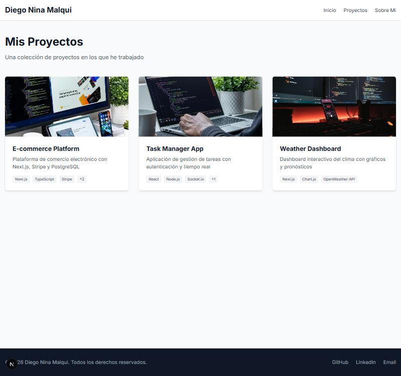

## 🗺️ Parte 3 — Sitemap y robots.txt

En vez de archivos estáticos, `sitemap.ts` y `robots.ts` son funciones de Next.js que generan `/sitemap.xml` y `/robots.txt` en tiempo de build/request a partir de los mismos datos de la aplicación (la lista de proyectos), evitando que el sitemap quede desincronizado del contenido real.

<table>
<tr>
<td width="50%">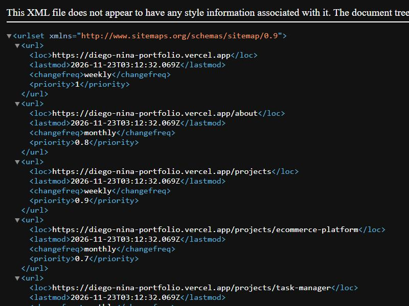</td>
<td width="50%">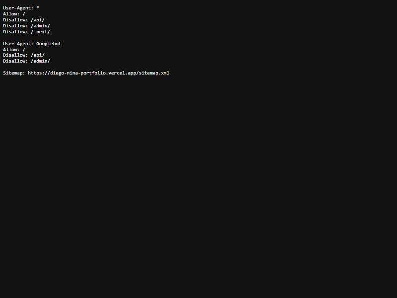</td>
</tr>
</table>

## 🔬 Verificación con Chrome DevTools y Lighthouse

<details>
<summary><b>Ver etiquetas Open Graph inspeccionadas en DevTools</b></summary>
<br>
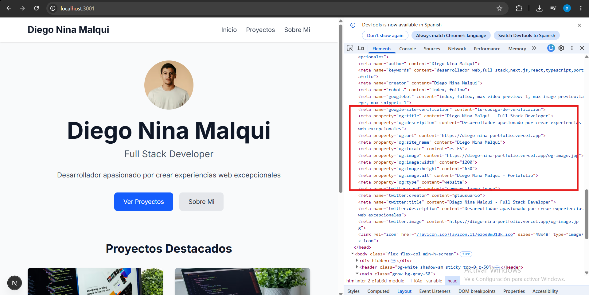
</details>

<details open>
<summary><b>Resultados de Lighthouse — Desktop y Mobile</b></summary>
<br>
<table>
<tr>
<td width="50%">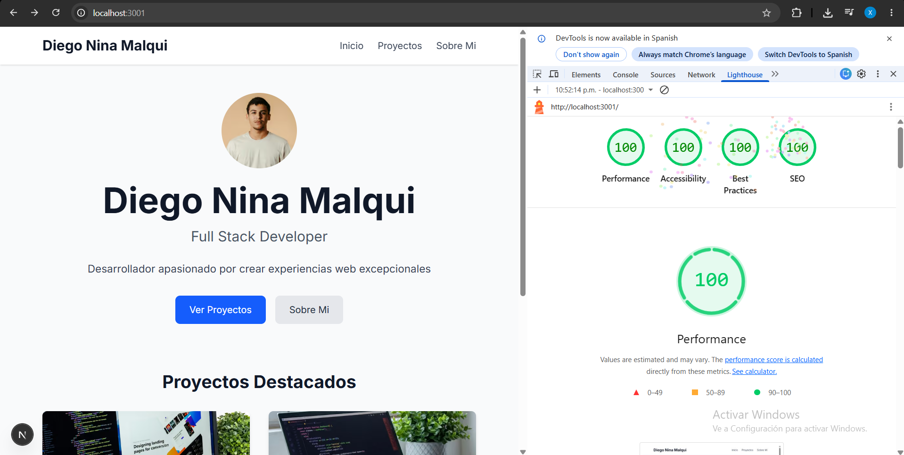</td>
<td width="50%"></td>
</tr>
</table>

| Modo | Performance | Accessibility | Best Practices | SEO |
|---|---|---|---|---|
| Desktop | 100 | 100 | 100 | 100 |
| Mobile | 93 | 100 | 100 | 100 |

</details>

## 🎯 Tarea — Contacto, despliegue y dominio

### Página de contacto

El formulario de `/contact` envía el mensaje mediante un enlace `mailto:` construido en el cliente (sin backend propio), que abre el cliente de correo del visitante con el asunto y cuerpo prellenados. La ruta quedó enlazada en el `Header` y agregada al `sitemap.ts` con `changeFrequency: yearly`, dado que es una página que cambia muy poco.

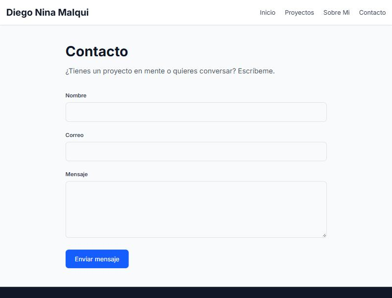

### Despliegue en Vercel

- **Repositorio:** [github.com/diegoninam-ship-it/Lab14-DAWA](https://github.com/diegoninam-ship-it/Lab14-DAWA)
- **Aplicación en Vercel:** [my-portfolio-phi-hazel-45.vercel.app](https://my-portfolio-phi-hazel-45.vercel.app)

<table>
<tr>
<td width="50%">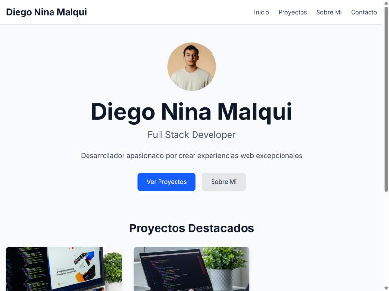</td>
<td width="50%">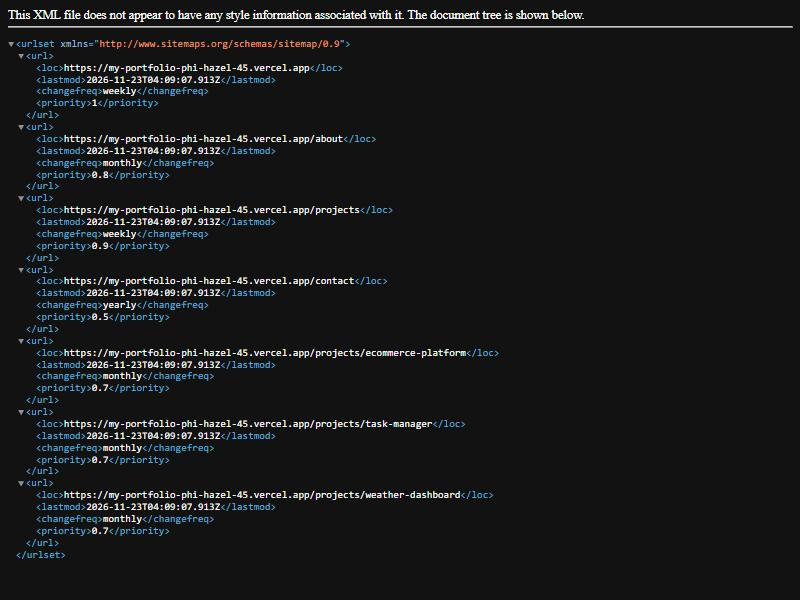</td>
</tr>
</table>

### Dominio personalizado (is-a.dev)

⏳ **Dominio personalizado pendiente:** se solicitó el subdominio gratuito `diego-nina.is-a.dev` vía Pull Request en [is-a-dev/register](https://github.com/is-a-dev/register/pull/62533), pendiente de aprobación por el equipo del proyecto al momento de esta entrega. Mientras tanto, la aplicación está disponible en el dominio de Vercel indicado arriba.

<table>
<tr>
<td width="50%">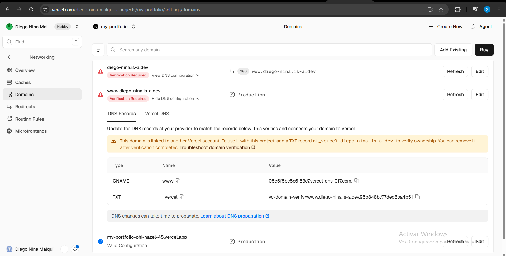</td>
<td width="50%">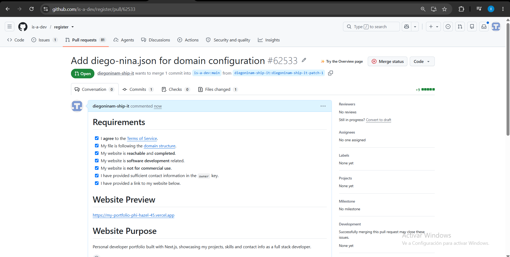</td>
</tr>
</table>

## 📝 Conclusiones

Este laboratorio mostró que el SEO en una aplicación Next.js moderna no es una capa que se agrega al final, sino un conjunto de decisiones que se toman en cada ruta: qué Server Component puede exportar `metadata` directamente y cuál necesita un `layout.tsx` auxiliar por ser Client Component, cómo mantener el `sitemap.xml` sincronizado con los datos reales en vez de un archivo estático que se desactualiza, y por qué `next/image` con `remotePatterns` evita tener que optimizar manualmente cada imagen externa.

La verificación con Lighthouse confirmó que estas decisiones sí se traducen en resultados medibles (100/100/100/100 en Desktop, 93/100/100/100 en Mobile), pero también dejó una lección aparte: auditar en modo desarrollo (`next dev`) da scores artificialmente bajos, por lo que el build de producción (`next build && next start`) es un paso obligatorio antes de medir, no opcional.

La parte de despliegue y dominio terminó siendo la más instructiva fuera del código: automatizar un login OAuth de CLI (Vercel, GitHub) es viable porque el flujo abre el navegador del propio usuario, pero automatizar la *creación de un Pull Request* en un repositorio ajeno no lo es — `is-a-dev/register` tiene una política explícita contra PRs generados por IA, y respetarla significó devolverle el control al usuario en el momento justo, en vez de forzar una automatización completa solo porque era técnicamente posible. Ese PR (is-a-dev/register#62533) sigue pendiente de revisión externa al cierre de este laboratorio, lo cual es parte normal de depender de un servicio de terceros con tiempos que no se controlan.

## 👤 Autor

**Diego Nina Malqui** — Estudiante de Diseño y Desarrollo de Software, Tecsup
📍 Laboratorio 14 · Desarrollo de Aplicaciones Web Avanzado

<div align="center">

⭐ *Si este repo te sirvió de guía, no olvides dejar una estrella* ⭐

</div>
